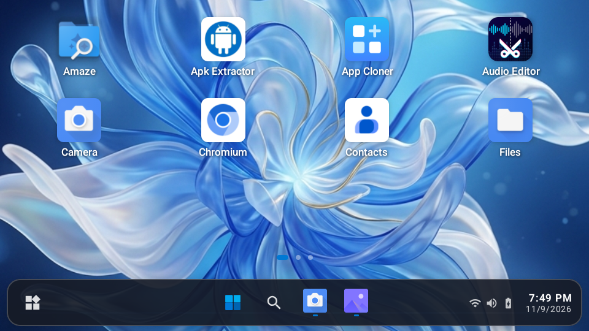
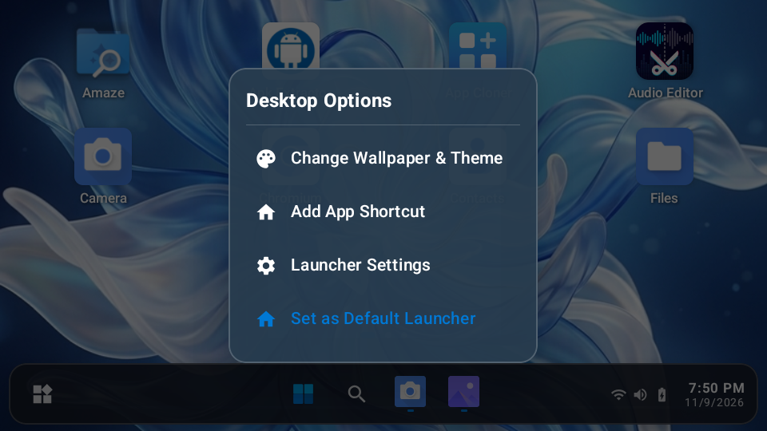
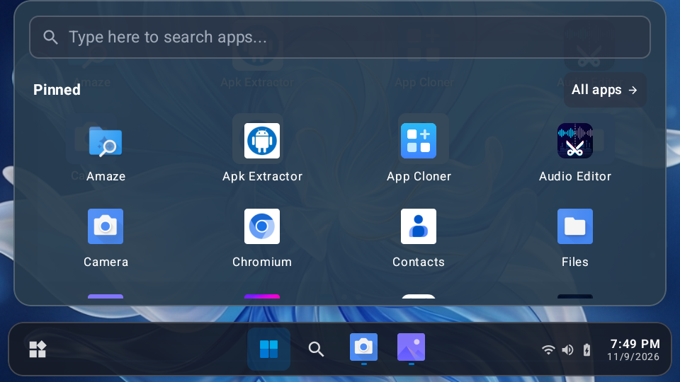
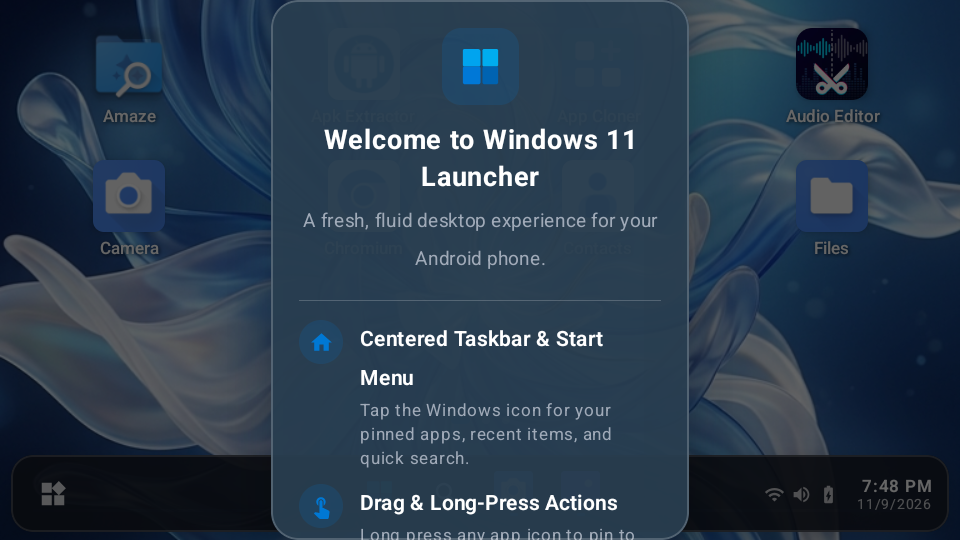
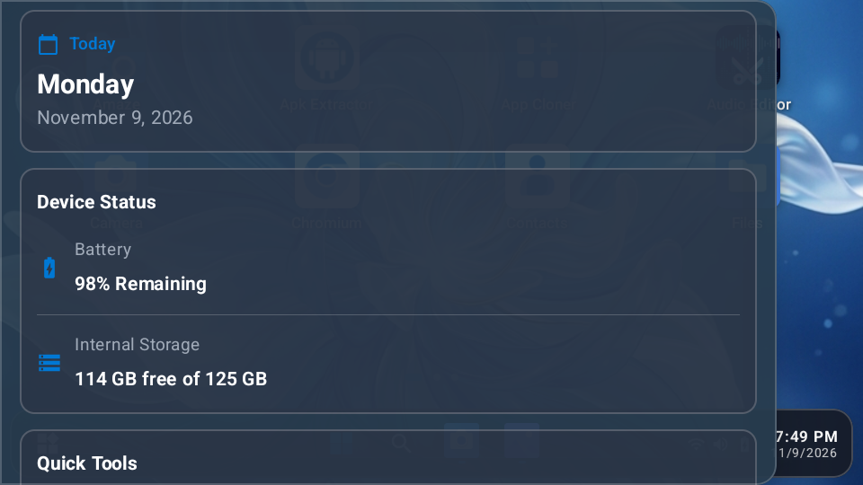

🖥️ Windows 11 Launcher
By KSGO Technology ⚙

Bring the Windows 11 experience to your Android device!

**Windows 11 Launcher** is an Android application designed to give your phone a desktop-inspired interface, combining a modern Windows-style look with useful customization features.

✨ Features

- 🪟 Windows-inspired interface.
- 🎨 Customizable wallpapers.
- 🖼️ Set wallpapers directly from your device's gallery.
- 🪟 Window Mode style.
- 🎯 Collection of icons for Google apps.
- 📱 Start menu and widgets.
- ⚡ Smooth and user-friendly experience.

📸 Screenshots

| Home | Long Press |
|---|---|
|  |  |

| Start Menu | Welcome |
|---|---|
|  |  |

| Widgets |
|---|
|  |

📥 Download

Get the latest version from the official GitHub Releases page:

👉 [**Download Windows 11 Launcher**](https://github.com/kingstudiosofficial12-lgtm/Windows-11-Launcher-Android-6-/releases/latest)

🔄 Release History

Visit the [Releases](https://github.com/kingstudiosofficial12-lgtm/Windows-11-Launcher-Android-6-/releases) page to explore available versions and updates.

🏢 About KSGO Technology

**KSGO Technology ⚙** is part of King Studios Group Official (KSGO), an independent creative and technology initiative focused on developing applications, games, digital experiences, and creative projects.

Our goal is to turn ideas into real products.

⚠️ Disclaimer

Windows 11 Launcher is an independent Android project. It is not affiliated with, endorsed by, or officially connected to Microsoft Corporation.

Windows is a trademark of Microsoft Corporation.

📄 License

All rights reserved © 2026 KSGO Technology ⚙
----------------------------------------------------------------------------------------------------------------------------------------------------------------------------------------------------------------------
**Made with passion, creativity, and determination.**
**KSGO Technology ⚙ || ©️2026**

*Dream it. Build it. Launch it.* 🚀
